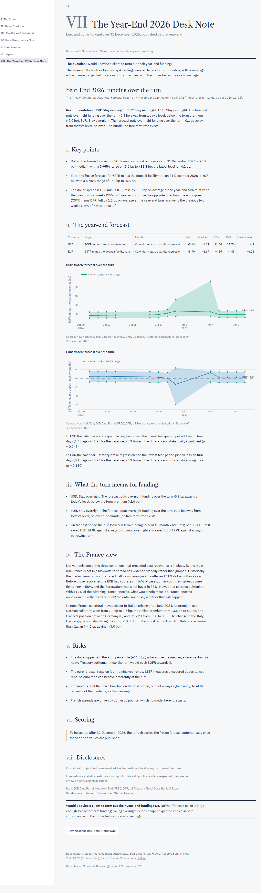

# The Price of Collateral

A quantitative research dashboard on repo markets, built as a portfolio project for a sales and
trading (repo desk) role. Focus: euro repo, especially Italian BTP and French OAT collateral against
German Bunds, with the United States (SOFR) and Japan as comparisons. It ends with a Year-End 2026
desk note whose forecast was frozen before the turn and is scored automatically afterwards.

<!-- AUTO:START -->
## Key findings

All numbers are from data to **3 November 2026**. This block is regenerated by `scripts/update_readme.py` after every data refresh.

- **Do the ECB, the Fed and the BoJ keep overnight rates where they want them, and what happens as balance sheets shrink?** Mostly: 2 of 3 held tightly. Past-year median spread to the policy rate: €STR -6.8 bp (IQR 0.4 bp), SOFR +0.0 bp (IQR 3.0 bp), TONA -2.3 bp (IQR 0.1 bp). As balance sheets shrink, SOFR has drifted up relative to the Fed's interest on reserves, about 6.4 bp per trillion of reserves lost (95% CI 5.1 to 7.9 bp). *Holds in all 5 robustness checks (R3).*
- **Is the extra repo cost of Italian and French collateral about credit risk or scarcity?** Too close to call. Italian collateral: too close to call between credit and scarcity; French collateral: neither clearly credit nor scarcity. For Italy collateral the credit effect minus the scarcity effects is -2.2 bp (95% CI -12.7 to +1.5 bp); it includes zero, so the data cannot say which channel is larger: too close to call. For France collateral the credit effect minus the scarcity effects is -3.0 bp (95% CI -9.1 to -0.7 bp); it lies below zero, so the scarcity effects are larger than the credit effect. The relationship broke at the start of quantitative tightening for both countries (Holm-adjusted). *Holds in 4 of 5 robustness checks (R4).*
- **Will French OATs bounce back, and what would it take?** Not yet: only one of the three conditions that preceded past recoveries is in place. By the daily rule France has been in a blowout episode since 28 September 2026, with the OAT-Bund spread at 162 bp on 3 November 2026; it does not meet the gradual-deterioration rule; the monthly rule, whose data end earlier, does not yet show it. For a blowout of its current age, 59% of past euro episodes retraced half the widening within the next 12 months. Historically the median euro blowout retraced half its widening in 9 months and 61% did so within a year. Before those recoveries the ECB had cut rates in 56% of cases, other countries' spreads were tightening in 58%, and the Eurosystem was a net buyer in 83%. Now: other spreads tightening. With 119% of the widening France-specific, what would help most is a France-specific improvement in the fiscal outlook; the data cannot say whether that will happen. *Holds in 5 of 6 robustness checks (R5); Holds in all 4 robustness checks (R6).*
- **Why do euro year-ends behave differently from dollar year-ends, and can funding spikes be forecast?** Partly: the models beat a naive rule, but not significantly. On the test period from 2023, a quantile model with calendar and state variables beat the naive same-as-last-turn rule on turn days in dollars and euros (significantly in neither, after a Holm correction across the six model comparisons). Across every year-end in the data, dollar turns push funding costs up while euro turns push them down (+11.0 bp and -1.2 bp on an average year-end). Calibration of the 5-95% ranges on the test period: USD too narrow, EUR too wide. *Holds in 3 of 5 robustness checks (R1); Holds in all 4 robustness checks (R2).*
- **Does Japanese overnight pricing follow the BoJ out of negative rates?** Yes, since the exit; the regime changes passed through more slowly. 5 of 7 BoJ policy changes since 2016 reached TONA on the effective day. After the exit, a gap between TONA and the policy rate halves in 0.4 business days (95% CI 0.3 to 0.6), against 13.2 (95% CI 9.7 to 17.8) under negative rates. TONA now sits 2.3 bp below the policy rate. *Holds in all 5 robustness checks (R7).*
- **Would I advise a client to term out their year-end funding?** No. Stay overnight in both currencies. Dollar term funding is currently cheaper than overnight, but the forecast expects overnight funding over the turn window to fall by more than that discount; in euros the expected excess cost is below the hurdle. The upper tail is the risk to manage. *Holds in all 4 robustness checks (1 not computable) (R8).*

Confidence intervals, Holm-adjusted p-values and the robustness checks behind each finding are in [docs/RESEARCH_NOTE.md](docs/RESEARCH_NOTE.md) and the dashboard's appendix.

Automated tests: **208** (pytest, offline), run on every push and before every data refresh is committed.
<!-- AUTO:END -->

## The seven chapters

| # | Chapter | The question |
|---|---|---|
| I | The Story | What is repo, and why does the bond you hand over matter? |
| II | Three Corridors | Do the ECB, the Fed and the BoJ keep overnight rates where they want them, and what happens as balance sheets shrink? |
| III | The Price of Collateral | Is the extra repo cost of Italian and French collateral about credit risk or scarcity? |
| IV | Italy Then, France Now | Will French OATs bounce back, and what would it take? |
| V | The Calendar | Why do euro year-ends behave differently from dollar year-ends, and can funding spikes be forecast? |
| VI | Japan | Does Japanese overnight pricing follow the BoJ out of negative rates? |
| VII | The Year-End 2026 Desk Note | Would I advise a client to term out their year-end funding? |

Every chapter opens with the question and a generated answer; every conclusion on the page is built
from the numbers by `src/wording.py`, never typed. Screenshots (headless Chrome, `scratch/screenshots.py`):
[I](docs/images/1_story.png) · [II](docs/images/2_corridors.png) · [III](docs/images/3_collateral.png) ·
[IV](docs/images/4_france.png) · [V](docs/images/5_calendar.png) · [VI](docs/images/6_japan.png) ·
[VII](docs/images/7_desk_note.png).



## Methodology highlights

Full detail, every fixed choice and the corrections log: [docs/METHODOLOGY.md](docs/METHODOLOGY.md).

- **No look-ahead, publication lags respected.** Every series carries its measured publication lag
  (`src/sources.py`); model inputs for day t only use values published by day t (`data.point_in_time`).
- **Choices fixed before results.** Train/test split (train to 2022, test from 2023), the 40-business-day
  horizon, calendar features, the blowout threshold (30 bp), break dates (QT on 1 March 2023, the
  dissolution on 9 June 2024), the model-selection rule and the desk-note client rule were written down
  before the results were computed. One correction (a sample filter in Phase 2) is logged with before
  and after numbers.
- **Forecasting (V, VII).** A naive "same as the last comparable turn" baseline, a calendar-only quantile
  regression and a calendar + state quantile regression forecast the median and the 5th, 90th and 95th
  percentiles; judged by pinball loss, interval coverage and Diebold-Mariano tests on the test period.
- **Corridors (II).** Two-regime Markov switching fitted on the train period; linear, piecewise and
  S-shaped reserve curves chosen out of sample, with block-bootstrap bands on where pressure starts.
- **Collateral (III).** MMSR repo rates by collateral country (maintenance-period averages) against
  credit (yield spreads) and scarcity (liquidity, Eurosystem holdings), Newey-West errors, a Chow test
  at the start of QT, rolling coefficients.
- **France (IV).** Exact OAT/Bund leg decomposition, a euro-wide vs France-specific split, Kaplan-Meier
  survival of euro spread blowouts since 2008 (own implementation with Greenwood bands), repo treatment
  of French collateral, and an event study restricted to events with a verified official source.
- **Japan (VI).** Pass-through of every BoJ policy change since 2016 and an error-correction model.
- **Frozen forecast.** `results/forecasts/yearend_2026.json` stores the model version, data as-of date,
  creation time, git commit and a SHA-256 of the forecasting code; nothing ever overwrites it.

## How to run

```
py -3.14 -m venv .venv
.venv\Scripts\python -m pip install -r requirements.txt
.venv\Scripts\python -m pytest                     # offline test suite
.venv\Scripts\streamlit run app.py                 # the dashboard, http://localhost:8501
.venv\Scripts\python scripts\run_all.py            # recompute every result from the committed snapshot
.venv\Scripts\python scripts\refresh_snapshots.py  # download fresh data (the only code that downloads)
```

## Data pipeline

- **Sources** (all free, no key): ECB Data Portal, New York Fed Markets API, FRED, OFR Short-term
  Funding Monitor, US Treasury Fiscal Data, Bank of Japan API, Bundesbank. See
  [docs/DATA_SOURCES.md](docs/DATA_SOURCES.md) for series keys, coverage and publication lags.
- **Snapshots.** `scripts/refresh_snapshots.py` downloads, checks (`src/pipeline.py`) and validates
  (`src/validation.py`, PASS / WARN / FAIL; any FAIL stops before anything is written) the data, writes
  `results/snapshots/`, recomputes every result (`scripts/run_all.py`), scores the frozen forecast once
  31 December 2026 is in the data, and regenerates the block above. Report:
  [docs/DATA_VALIDATION.md](docs/DATA_VALIDATION.md).
- **The dashboard never downloads.** It reads only the committed files in `results/`.
- **Automation.** `.github/workflows/refresh-data.yml` runs each weekday at 14:00 UTC (after the previous
  day's SOFR and €STR are both published), checks that the frozen forecast is untouched, runs the tests
  and commits only if they pass and files changed. `.github/workflows/tests.yml` runs on every push.
- **Independent audit.** [docs/AUDIT.md](docs/AUDIT.md) recomputes key numbers without importing
  anything from `src/`.

## Limitations

- No free daily French or Italian 10-year yields: chapters III and IV run at monthly (yields) and
  maintenance-period (repo) frequency.
- No free daily euro repo rate: the euro forecast targets €STR (unsecured) minus the DFR, and the
  term-vs-overnight backtest is dollar-only.
- Small samples: four euro and five dollar training year-ends; 36 blowout episodes that overlap in time;
  two verifiable French political events. Results are base rates and evidence, not certainties.
- The BoJ policy rate is reconstructed (no daily series); JSDA's Tokyo Repo Rate was unavailable.
- The full list of data-driven changes to the original plan is in [CLAUDE.md](CLAUDE.md), "Plan adjustments".

Developed with AI pair-programming (Claude Code).

**Disclaimer.** Educational project. Not investment advice. No position is held in any instrument
discussed. Forecasts are statistical estimates from public data, not views on central bank decisions.
