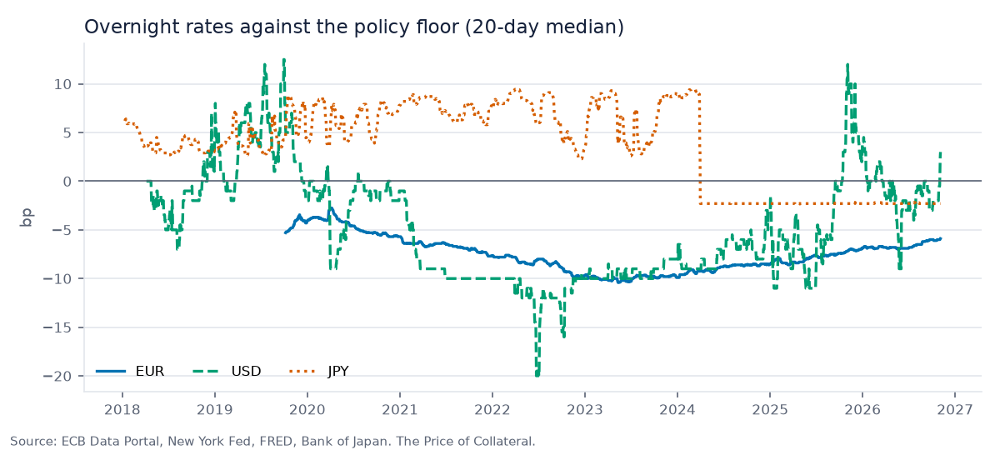
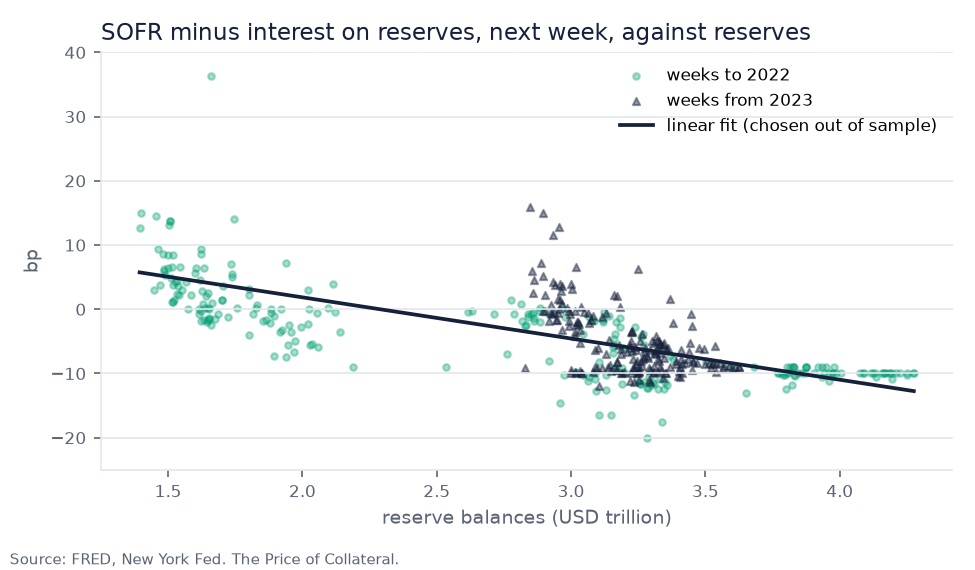
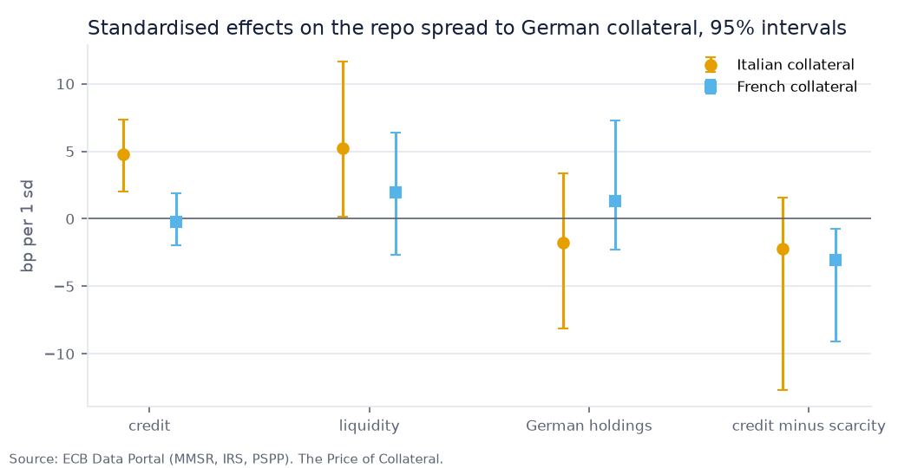
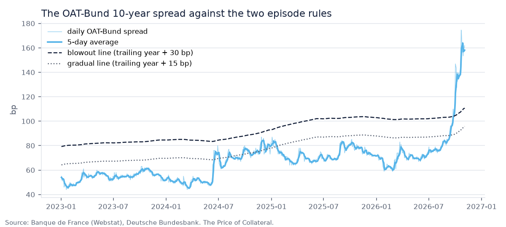
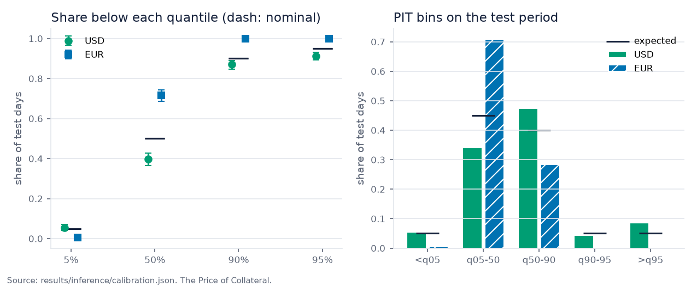
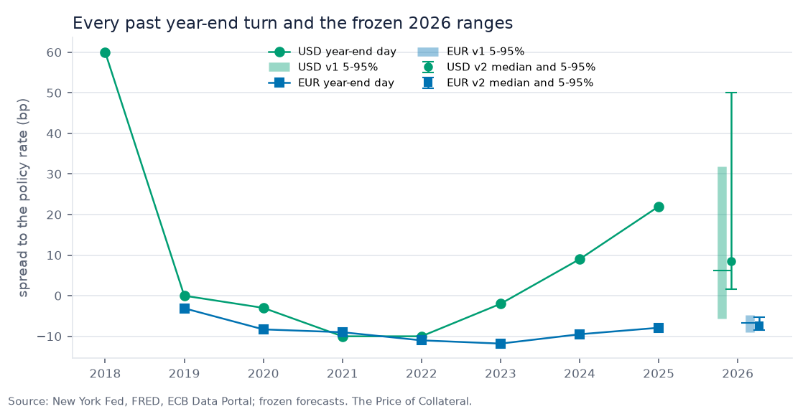

# The Price of Collateral: repo spreads, collateral premia and a frozen year-end forecast

*Research note generated by `scripts/build_note.py` from the committed results (data as of 3 November 2026). Every number and every conclusion below is produced from the results files; nothing is typed by hand. Educational project, not investment advice.*

## Abstract

This note studies overnight funding in euro, dollar and yen money markets, the premium that Italian and French government bonds command as repo collateral against German Bunds, and the year-end turn. Every modelling choice was fixed in `docs/METHODOLOGY.md` before its result was computed, publication lags are respected so no model sees data before it was published, and forecasts are judged on a held-out test period from 2023. The main answers are:

- **Do the ECB, the Fed and the BoJ keep overnight rates where they want them, and what happens as balance sheets shrink?** Mostly: 2 of 3 held tightly.
- **Is the extra repo cost of Italian and French collateral about credit risk or scarcity?** Too close to call.
- **Will French OATs bounce back, and what would it take?** Not yet: only one of the three conditions that preceded past recoveries is in place.
- **Why do euro year-ends behave differently from dollar year-ends, and can funding spikes be forecast?** Partly: the models beat a naive rule, but not significantly.
- **Does Japanese overnight pricing follow the BoJ out of negative rates?** Yes, since the exit; the regime changes passed through more slowly.
- **Would I advise a client to term out their year-end funding?** No.

Uncertainty is reported as moving-block bootstrap intervals, every hypothesis test is corrected for multiple testing within its family (Holm), and each headline finding is re-derived under three to six alternative specifications fixed in advance.

## 1. Questions

1. What is repo, and why does the bond you hand over matter?
2. Do the ECB, the Fed and the BoJ keep overnight rates where they want them, and what happens as balance sheets shrink?
3. Is the extra repo cost of Italian and French collateral about credit risk or scarcity?
4. Will French OATs bounce back, and what would it take?
5. Why do euro year-ends behave differently from dollar year-ends, and can funding spikes be forecast?
6. Does Japanese overnight pricing follow the BoJ out of negative rates?
7. Would I advise a client to term out their year-end funding?

## 2. Data

All data are free and official or quasi-official; the dashboard and this note read only the committed snapshot, which a scheduled pipeline refreshes after validation. Each series is used only after its publication lag (business days after the observation date):

| Series | Source | Frequency | Lag (business days) |
|---|---|---|---|
| Euro short-term rate | ECB (`EST/B.EU000A2X2A25.WT`) | daily | 1 |
| Secured overnight financing rate | NYFED (`SOFR`) | daily | 1 |
| Uncollateralized overnight call rate | BOJ (`FM01/STRDCLUCON`) | daily | 2 |
| Reserve balances with Federal Reserve Banks | FRED (`WRESBAL`) | weekly | 1 |
| Euro liquidity proxy (current accounts + deposit facility - marginal lending) | ECB | weekly | 2 |
| DVP term average rate: <=30 days to 13 Aug 2025, 8-30 days afterwards | OFR (`REPO-DVP_AR_LE30|REPO-DVP_AR_B830`) | daily | 1 |
| French 10-year constant-maturity government yield | WEBSTAT (`FM.D.FR.EUR.FR2.BB.FRMOYTEC10.HSTA`) | daily | 1 |
| Daily yield of the current 10-year Bund | BBK (`BBSSY/D.REN.EUR.A630.000000WT1010.A`) | daily | 1 |
| Long-term interest rate for convergence purposes, IT | ECB (`IRS/M.IT.L.L40.CI.0000.EUR.N.Z`) | monthly | 25 |
| MMSR secured rates by collateral country | ECB | maintenance period | 10 |

Validation (`docs/DATA_VALIDATION.md`): 10 checks passed, 0 warnings, 0 failures. Limitations: no free daily euro repo rate exists, so the euro forecasting target is €STR (an unsecured rate) minus the deposit facility rate; MMSR collateral-specific repo rates are maintenance-period averages rounded to 1 bp; daily 10-year yields are available free only for France (Banque de France TEC10) and Germany (Bundesbank), so cross-country work on spreads is monthly; French CDS, auction results and haircut histories are not free and are not used.

## 3. Methods

**Corridors.** The spread of each overnight rate to its policy floor is described by regime, by a two-state Markov-switching model with switching mean and variance (Hamilton, 1989) estimated to 2022 and run forward, and, for the dollar and euro, by the link between central bank liquidity and the next week's spread: linear, one-kink piecewise and logistic fits chosen by out-of-sample error. A kink at the edge of its search grid is reported as not identified.

**Collateral.** For Italian and French collateral, the maintenance-period MMSR repo spread to German collateral is regressed on a credit proxy (the 10-year yield spread) and two scarcity proxies (euro liquidity and Eurosystem holdings of Bunds), with Newey-West errors (Newey and West, 1987); effects are compared in standard-deviation units, with a Chow (1960) break test at the start of quantitative tightening.

**France.** The OAT-Bund spread is split exactly into an OAT leg and a Bund leg, and into a euro-wide part (implied by Italian and Spanish spreads, estimated 2010-2023) and a France-specific residual. Episodes are defined by two pre-registered rules: a blowout (the 5-day average at least 30 bp above its trailing-year mean) and a gradual deterioration (at least 15 bp above for six consecutive months). Recovery is half retracement; base rates come from a Kaplan-Meier estimator (Kaplan and Meier, 1958) with Greenwood bands on the log-log scale over ten euro countries since 2008. Events are studied in two-day windows against every two-day window since 2010.

**Forecasting.** Three models forecast the 5th, 50th, 90th and 95th percentiles of each spread 40 business days ahead: a naive same-as-last-comparable-turn rule, a calendar-only linear quantile regression (Koenker and Bassett, 1978), and a calendar-plus-state regression. They are fitted to 2022 and scored on 2023 onward with the pinball loss (Gneiting and Raftery, 2007), tested against the baseline with the Diebold and Mariano (1995) test with the Harvey, Leybourne and Newbold (1997) correction. The 2026 year-end forecast (v1) was frozen on 4 November 2026. A challenger (v2), designed after seeing v1's test calibration, uses conformalised quantile regression (Romano, Patterson and Candès, 2019) and an empirical distribution of past year-end jumps; it was frozen on 5 November 2026.

**Japan.** An error-correction regression (Engle and Granger, 1987) of daily TONA changes on the lagged gap to the policy rate gives the half-life of a gap, before and after the exit from negative rates.

**Inference.** Intervals are 95% moving-block bootstrap percentiles (Künsch, 1989), 1,000 resamples, with block lengths fixed in advance (40 business days for forecast losses, 8 weeks for reserves, 4 maintenance periods for collateral, 6 months for the euro-wide split, 20 business days for Japan). There are 42 hypothesis tests in 8 families; Holm's (1979) step-down correction is applied within each family and every sentence that says "significant" uses the adjusted value. Calibration uses exact Clopper and Pearson (1934) intervals and a probability integral transform histogram (Diebold, Gunther and Tay, 1998).

## 4. Results

### 4.1 Three corridors

Past-year median spread to the policy rate: €STR -6.8 bp (IQR 0.4 bp), SOFR +0.0 bp (IQR 3.0 bp), TONA -2.3 bp (IQR 0.1 bp). As balance sheets shrink, SOFR has drifted up relative to the Fed's interest on reserves, about 6.4 bp per trillion of reserves lost (95% CI 5.1 to 7.9 bp).

Out of sample, the best description of the link between reserve balances (USD trillion) and the spread is linear: the spread rises by about 6.4 bp for each 1 trillion less. The point where pressure starts is not identified: the estimated kink lies at the edge of the range searched (77% of bootstrap estimates sit at the edge of the search range), so the data cannot place it. Bootstrap interval of the slope: 95% CI -7.9 to -5.1 bp per trillion.

Out of sample, the best description of the link between liquidity (EUR trillion) and the spread is linear: the spread rises by about 1.2 bp for each 1 trillion less. The estimated point where pressure starts is 3.19 trillion (a reference only: the threshold model did not win out of sample), with a 95% band of 2.43 to 4.09; the latest level, 2.27, is below that band. Bootstrap interval of the slope: 95% CI -1.7 to -0.7 bp per trillion.

### 4.2 The price of collateral: credit or scarcity?

Italian collateral cost 11.0 bp more than German collateral in repo on average (latest +3.0 bp). The regression explains 51% of the variation and reads as too close to call between credit and scarcity: a one-standard-deviation move in the yield spread is worth +4.8 bp, the two scarcity measures together 7.0 bp.

For Italian collateral the credit effect minus the scarcity effects is -2.2 bp (95% CI -12.7 to +1.5 bp); it includes zero, so the data cannot say which channel is larger: too close to call.
 The relationship for Italian collateral changed at the start of quantitative tightening; the break is statistically significant (Holm-adjusted p = 0.035): neither clearly credit nor scarcity before, mainly scarcity of German collateral after.

French collateral cost 6.2 bp more than German collateral in repo on average (latest +4.0 bp). The regression explains 37% of the variation and reads as neither clearly credit nor scarcity: a one-standard-deviation move in the yield spread is worth -0.2 bp, the two scarcity measures together 3.2 bp.

For French collateral the credit effect minus the scarcity effects is -3.0 bp (95% CI -9.1 to -0.7 bp); it lies below zero, so the scarcity effects are larger than the credit effect.
 The relationship for French collateral changed at the start of quantitative tightening; the break is statistically significant (Holm-adjusted p < 0.001); it reads as neither clearly credit nor scarcity both before and after.

**Answer.** Too close to call.

### 4.3 Italy then, France now

On 3 November 2026 the OAT-Bund spread was 162 bp; its five-day average, 158 bp, was 77 bp above its trailing one-year average (81 bp). By the daily blowout rule (30 bp) France has been in an episode since 28 September 2026; the peak so far is 164 bp, so half the widening is retraced at 119 bp. Of past euro blowouts that had lasted this long, 59% retraced half the widening within the following 12 months (monthly 10-country base rate). It does not meet the gradual-deterioration rule (15 bp above the trailing average for six months): the excess built up within weeks, not over half a year. The monthly rule, whose data end earlier, does not yet show the episode.

From 7 June 2024 to 3 November 2026 the OAT-Bund spread went from 49 bp to 162 bp. OAT yields rose by 187 bp and Bund yields rose by 74 bp, so the widening came from the OAT leg, partly offset by the Bund leg.

Since 2024-06 the French spread moved +45.5 bp: -8.8 bp is what Italian and Spanish spreads would have implied (euro-wide, 95% CI -34 to +21 bp), +54.3 bp is France-specific (119% of the move, 95% CI +25 to +80 bp). The move has been mainly France-specific, and the France-specific part is clearly above zero.

Across 36 blowouts of 30 bp or more in 10 euro countries since 2008, the median time to retrace half the widening was 9 months; 61% had done so within a year (95% band 46% to 77%). The sample is small and the episodes overlap in time, so these are base rates, not forecasts.
 Gradual deteriorations are common: 27 episodes in 10 euro countries since 2008 by the same rule on monthly data; the median retraced half its widening in 13 months and 41% within a year.

**Events.** 11 events met the two-source rule (official sites, Bloomberg and CNBC; Reuters, the Financial Times, Le Monde and Les Echos could not be reached by the search tool). Across the 11 verified events, the spread widened in 6 of 11 two-day windows (average change +1.1 bp); 4 of 11 were unusually large (90th percentile of all two-day changes or above).

| Date | Event | Two-day change (bp) | Percentile |
|---|---|---|---|
| 2024-06-09 | President Macron dissolves the National Assembly | +15.0 | 99% |
| 2024-10-25 | Moody's moves France's Aa2 outlook to negative | +1.0 | 65% |
| 2024-12-04 | The National Assembly adopts a motion of censure; the Barnier government falls | -1.0 | 26% |
| 2024-12-13 | Moody's downgrades France to Aa3 (Friday evening) | +4.0 | 92% |
| 2025-09-08 | The National Assembly refuses its confidence to the Bayrou government (article 49, paragraph 1) | -1.0 | 28% |
| 2025-09-12 | Fitch downgrades France to A+ (Friday evening) | +0.0 | 45% |
| 2025-10-06 | Prime Minister Lecornu resigns; his first government falls | +4.0 | 93% |
| 2025-10-17 | S&P downgrades France to A+ (Friday evening, unscheduled) | +2.0 | 80% |
| 2025-10-24 | Moody's moves France's Aa3 outlook to negative | +0.0 | 45% |
| 2026-10-23 | Moody's periodic review keeps France at Aa3, outlook negative (no rating action) | -18.2 | 0% |
| 2026-10-30 | Fitch moves France's A+ outlook to negative (unscheduled) | +6.5 | 96% |

**Answer.** Not yet: only one of the three conditions that preceded past recoveries is in place. By the daily rule France has been in a blowout episode since 28 September 2026, with the OAT-Bund spread at 162 bp on 3 November 2026; it does not meet the gradual-deterioration rule; the monthly rule, whose data end earlier, does not yet show it. For a blowout of its current age, 59% of past euro episodes retraced half the widening within the next 12 months. Historically the median euro blowout retraced half its widening in 9 months and 61% did so within a year. Before those recoveries the ECB had cut rates in 56% of cases, other countries' spreads were tightening in 58%, and the Eurosystem was a net buyer in 83%. Now: other spreads tightening. With 119% of the widening France-specific, what would help most is a France-specific improvement in the fiscal outlook; the data cannot say whether that will happen.

### 4.4 The calendar and the forecasts

The dollar spread (SOFR minus IOR) rose by 11.0 bp on average at the year-end turn relative to the previous two weeks (75% of 8 year-ends up); in the opposite direction, the euro spread (€STR minus DFR) fell by 1.2 bp on average at the year-end turn relative to the previous two weeks (14% of 7 year-ends up). The pattern fits the two market structures: in dollars, banks shrink their balance sheets for year-end reporting and stop intermediating repo, so cash borrowers pay up; in euros, €STR is a deposit rate that banks pay to non-banks, and when banks turn deposits away at year-end, that rate falls further below the deposit facility rate.

In USD the calendar + state quantile regression had the lowest test-period pinball loss on turn days (1.48 against 1.98 for the baseline, 25% lower); the difference is not statistically significant (Holm-adjusted p = 0.130); the block-bootstrap interval of the loss difference (95% CI -1.14 to -0.06) excludes zero.

In EUR the calendar + state quantile regression had the lowest test-period pinball loss on turn days (0.18 against 0.23 for the baseline, 23% lower); the difference is not statistically significant (Holm-adjusted p = 0.360); the block-bootstrap interval of the loss difference (95% CI -0.14 to +0.01) includes zero.

| Currency | Model | Turn-day pinball | All-day pinball | DM p (turns) | Holm-adjusted | 5-95% coverage |
|---|---|---|---|---|---|---|
| USD | Baseline: same as the last comparable turn | 1.98 | 0.91 | n/a | n/a | 90.9% |
| USD | Calendar-only quantile regression | 2.07 | 1.22 | 0.812 | 0.812 | 94.6% |
| USD | Calendar + state quantile regression | 1.48 | 0.81 | 0.043 | 0.130 | 85.8% |
| EUR | Baseline: same as the last comparable turn | 0.23 | 0.12 | n/a | n/a | 87.4% |
| EUR | Calendar-only quantile regression | 0.55 | 0.44 | < 0.001 | < 0.001 | 70.9% |
| EUR | Calendar + state quantile regression | 0.18 | 0.10 | 0.180 | 0.360 | 99.4% |
| JPY | Baseline: same as the last comparable turn | 0.67 | 0.52 | n/a | n/a | 83.7% |
| JPY | Calendar-only quantile regression | 1.87 | 1.95 | < 0.001 | < 0.001 | 23.0% |
| JPY | Calendar + state quantile regression | 1.73 | 1.80 | < 0.001 | < 0.001 | 24.7% |

- USD (calendar + state quantile regression): the 5-95% range contained the outcome on 85.8% of 958 test days (exact 95% CI 83.4% to 88.0%), below the nominal 90%: the ranges are too narrow. Verdict: too narrow.
- EUR (calendar + state quantile regression): the 5-95% range contained the outcome on 99.4% of 981 test days (exact 95% CI 98.7% to 99.8%), above the nominal 90%: the ranges are too wide. Verdict: too wide.
- JPY (baseline: same as the last comparable turn): the 5-95% range contained the outcome on 83.7% of 935 test days (exact 95% CI 81.2% to 86.1%), below the nominal 90%: the ranges are too narrow. Verdict: too narrow.

**Answer.** Partly: the models beat a naive rule, but not significantly. On the test period from 2023, a quantile model with calendar and state variables beat the naive same-as-last-turn rule on turn days in dollars and euros (significantly in neither, after a Holm correction across the six model comparisons). Across every year-end in the data, dollar turns push funding costs up while euro turns push them down (+11.0 bp and -1.2 bp on an average year-end). Calibration of the 5-95% ranges on the test period: USD too narrow, EUR too wide.

### 4.5 Japan

5 of 7 BoJ policy changes since 2016 reached TONA on the effective day. After the exit, a gap between TONA and the policy rate halves in 0.4 business days (95% CI 0.3 to 0.6), against 13.2 (95% CI 9.7 to 17.8) under negative rates. TONA now sits 2.3 bp below the policy rate. The bootstrap intervals of the two half-lives are 0.3 to 0.6 business days after the exit and 9.7 to 17.8 under negative rates.

### 4.6 Multiple testing

Of the 42 tests, 26 are significant at 5% before the correction and 22 after it. The full list is in the dashboard's appendix and `results/inference/tests.json`; the tests whose conclusion changes are:

| Family | Test | p | Holm-adjusted p |
|---|---|---|---|
| F1 | USD state vs baseline, turn days (Diebold-Mariano) | 0.043 | 0.130 |
| F3 | IT collateral: liquidity coefficient = 0 (HAC) | 0.023 | 0.113 |
| F4 | IT collateral, after QT: German holdings coefficient = 0 (HAC) | 0.007 | 0.059 |
| F4 | FR collateral, after QT: credit coefficient = 0 (HAC) | 0.010 | 0.076 |

## 5. Robustness

Each finding was re-derived under alternatives fixed before any was computed (`docs/METHODOLOGY.md`, U3):

| # | Finding | Result |
|---|---|---|
| R1 | The winning regression beats the naive baseline on test-period turn days (USD and EUR) | Holds in 3 of 5 robustness checks |
| R2 | Dollar year-ends push the spread up, euro year-ends push it down | Holds in all 4 robustness checks |
| R3 | SOFR rises relative to IOR as reserves fall (slope below zero, interval excludes zero) | Holds in all 5 robustness checks |
| R4 | Italy: too close to call; France: neither clearly credit nor scarcity | Holds in 4 of 5 robustness checks |
| R5 | France is in a blowout now (daily rule) | Holds in 5 of 6 robustness checks |
| R6 | The widening since June 2024 is mainly France-specific | Holds in all 4 robustness checks |
| R7 | Gaps close faster after the exit than under negative rates | Holds in all 5 robustness checks |
| R8 | Client verdict: stay overnight in both currencies | Holds in all 4 robustness checks (1 not computable) |

Where a conclusion does not hold: R1, horizon 20 business days (USD best 1.32 vs baseline 2.05; EUR best 0.21 vs baseline 0.21); R1, train end 2021 (test 2022 on) (USD best 1.55 vs baseline 1.67; EUR best 0.70 vs baseline 0.22); R4, MMSR overnight instead of spot-next (IT too close to call; FR scarcity); R5, monthly rule (ECB data to the last month) (not in an episode at 2026-09 (97 bp)).

## 6. The frozen Year-End 2026 forecasts

Forecast frozen on 4 November 2026, commit 8ad7172 (model forecast-v1, data as of 2026-11-03). v1 is the pre-registered headline; v2 is a challenger whose test-period results are not a clean out-of-sample claim because it was designed after seeing v1's.

| Currency | Forecast | 5% | Median | 90% | 95% |
|---|---|---|---|---|---|
| USD | v1 | -5.6 | +6.2 | +31.7 | +31.8 |
| USD | v2 | +1.6 | +8.5 | +34.4 | +50.1 |
| EUR | v1 | -9.0 | -6.7 | -4.8 | -4.8 |
| EUR | v2 | -8.5 | -7.5 | -5.9 | -5.2 |

- USD on 31 December 2026: v1 median +6.2 bp, 5-95% -5.6 bp to +31.8 bp; v2 median +8.5 bp, 5-95% +1.6 bp to +50.1 bp. The v2 range is 11.1 bp wider, and its 90th and 95th percentiles (+34.4 bp, +50.1 bp) are separated; its year-end distribution rests on 8 past year-ends.
- EUR on 31 December 2026: v1 median -6.7 bp, 5-95% -9.0 bp to -4.8 bp; v2 median -7.5 bp, 5-95% -8.5 bp to -5.2 bp. The v2 range is 0.9 bp narrower, and its 90th and 95th percentiles (-5.9 bp, -5.2 bp) are separated; its year-end distribution rests on 7 past year-ends.
- EUR (not a clean out-of-sample test: v2 was designed after seeing v1's test results): the CQR turn-day pinball loss was 0.34, higher than v1's 0.18 (baseline 0.23); its 5-95% range covered 62.5% of test days (too narrow; v1 99.4%). The year-end analogue's range contained all 3 of the 2023-2025 year-ends.
- USD (not a clean out-of-sample test: v2 was designed after seeing v1's test results): the CQR turn-day pinball loss was 1.93, higher than v1's 1.48 (baseline 1.98); its 5-95% range covered 91.6% of test days (well calibrated; v1 85.8%). The year-end analogue's range contained all 3 of the 2023-2025 year-ends.
- USD: the frozen 90th and 95th percentiles (+31.7 bp and +31.8 bp) are not separately identified. The year-end effect is fitted on only 8 year-ends with two year-end parameters; at the 90th and 95th percentiles both pass exactly through the same both year-ends (31 December 2018, 30 December 2021), and before sorting the 90th percentile (+31.76 bp) was above the 95th (+31.58 bp), so the two were swapped. With 8 year-ends, any quantile above 88% leaves no year-end above the fit, so the upper tail rests on the single largest past turns.
- EUR: the frozen 90th and 95th percentiles (-4.8 bp and -4.8 bp) are not separately identified. The year-end effect is fitted on only 7 year-ends with two year-end parameters; at the 90th and 95th percentiles both pass exactly through the same both year-ends (31 December 2019, 30 December 2022), and before sorting the 90th percentile (-4.83 bp) was above the 95th (-4.85 bp), so the two were swapped. With 7 year-ends, any quantile above 86% leaves no year-end above the fit, so the upper tail rests on the single largest past turns.

**Client verdict.** Would I advise a client to term out their year-end funding? **No.** Stay overnight in both currencies. Dollar term funding is currently cheaper than overnight, but the forecast expects overnight funding over the turn window to fall by more than that discount; in euros the expected excess cost is below the hurdle. The upper tail is the risk to manage.

- USD: Stay overnight. Over the 14 nights from 7 business days before the turn, the 31 December median is +6.2 bp, and the forecast puts overnight funding -4.1 bp away from today's level on average (weighted by nights), below the term premium (-2.0 bp: term funding is 2.0 bp cheaper than overnight).
- EUR: Stay overnight. Over the 14 nights from 7 business days before the turn, the 31 December median is -6.7 bp, and the forecast puts overnight funding -0.0 bp away from today's level on average (weighted by nights), below a 1 bp hurdle (no usable term rate).

Both forecasts are scored automatically once 31 December 2026 is published; To be scored after 31 December 2026: the refresh scores both frozen forecasts (v1 and v2) automatically once the year-end values are published.

## 7. Limitations

- Small samples in the tails: the year-end tail rests on 8 dollar and 7 euro year-ends, which is why v1's 90th and 95th percentiles are not separately identified.
- €STR is an unsecured deposit rate, not a repo rate; euro repo can behave differently at the turn.
- MMSR collateral-specific rates are maintenance-period averages (69 periods), rounded to 1 bp.
- The euro-wide split for France is monthly because daily Italian and Spanish yields are not free; the split's interval reflects only the estimation of the euro-wide beta.
- Binomial calibration intervals assume independent days; forecasts 40 days ahead overlap, so the block-bootstrap coverage intervals are the more honest ones.
- Event verification relied on Bloomberg, CNBC and official sites, mostly through search listings.
- Survival episodes overlap in time across countries (2010-2012), so base rates are not independent draws.

## References

**Data.** ECB Data Portal (€STR, policy rates, ILM, MMSR, IRS); ECB PSPP breakdown; Banque de France Webstat (TEC10); Deutsche Bundesbank statistics (10-year Bund); Federal Reserve Bank of New York Markets API (SOFR, TGCR, BGCR, EFFR); FRED, Federal Reserve Bank of St. Louis (IORB, IOER, target range, reserves, ON RRP, Fed repo operations); Office of Financial Research Short-term Funding Monitor (DVP repo); US Treasury Fiscal Data (auctions, Daily Treasury Statement); Bank of Japan Time-Series Data Search (TONA, call rates, current accounts, basic loan rate); Assemblée nationale; Bloomberg, CNBC, Moody's and Agence France Trésor (events).

- Chow, G. C. (1960). Tests of equality between sets of coefficients in two linear regressions. Econometrica 28(3).
- Clopper, C. J. and Pearson, E. S. (1934). The use of confidence or fiducial limits illustrated in the case of the binomial. Biometrika 26(4).
- Diebold, F. X., Gunther, T. A. and Tay, A. S. (1998). Evaluating density forecasts with applications to financial risk management. International Economic Review 39(4).
- Diebold, F. X. and Mariano, R. S. (1995). Comparing predictive accuracy. Journal of Business and Economic Statistics 13(3).
- Engle, R. F. and Granger, C. W. J. (1987). Co-integration and error correction. Econometrica 55(2).
- Gneiting, T. and Raftery, A. E. (2007). Strictly proper scoring rules, prediction, and estimation. Journal of the American Statistical Association 102(477).
- Greenwood, M. (1926). The natural duration of cancer. Reports on Public Health and Medical Subjects 33.
- Hamilton, J. D. (1989). A new approach to the economic analysis of nonstationary time series and the business cycle. Econometrica 57(2).
- Harvey, D., Leybourne, S. and Newbold, P. (1997). Testing the equality of prediction mean squared errors. International Journal of Forecasting 13(2).
- Holm, S. (1979). A simple sequentially rejective multiple test procedure. Scandinavian Journal of Statistics 6(2).
- Kalbfleisch, J. D. and Prentice, R. L. (1980). The Statistical Analysis of Failure Time Data. Wiley.
- Kaplan, E. L. and Meier, P. (1958). Nonparametric estimation from incomplete observations. Journal of the American Statistical Association 53(282).
- Koenker, R. and Bassett, G. (1978). Regression quantiles. Econometrica 46(1).
- Künsch, H. R. (1989). The jackknife and the bootstrap for general stationary observations. Annals of Statistics 17(3).
- Newey, W. K. and West, K. D. (1987). A simple, positive semi-definite, heteroskedasticity and autocorrelation consistent covariance matrix. Econometrica 55(3).
- Romano, Y., Patterson, E. and Candès, E. (2019). Conformalized quantile regression. Advances in Neural Information Processing Systems 32.
